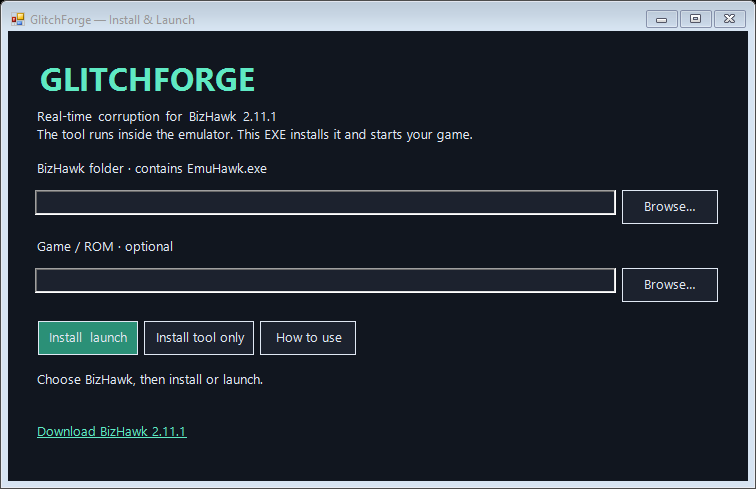
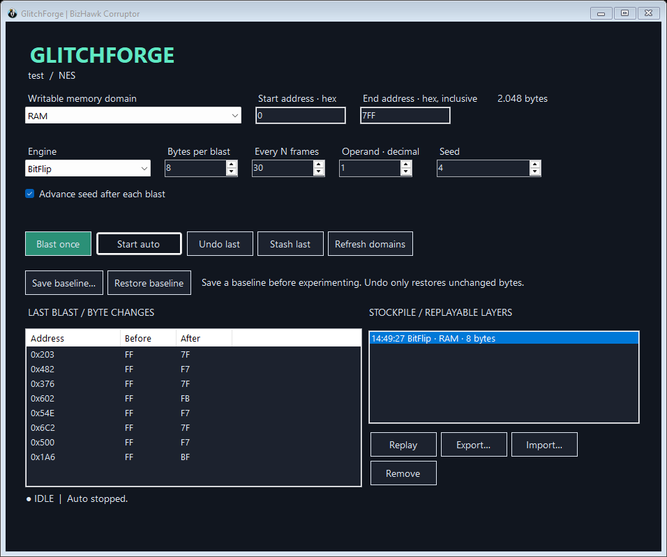

# GlitchForge — BizHawk real-time corruptor

A working Windows external tool inspired by RTCV's memory-domain, blast-layer, and stockpile workflow. Original C# implementation using BizHawk's external-tool API. No modified emulator is required.



## Install

**EXE:** Download `GlitchForge.exe` from [GitHub Releases](https://github.com/noodle7077/GlitchForge/releases), run it, choose your extracted **stock BizHawk 2.11.1** folder, and select **Install & launch**. You can optionally choose a ROM to open the game and corruptor together. The EXE embeds the plugin; you do not need to keep a separate DLL beside it. Requires Windows with .NET Framework 4.8. It does not bundle an emulator or ROMs.

**Manual DLL installation:**

1. Download and extract [stock BizHawk 2.11.1 for Windows](https://github.com/TASEmulators/BizHawk/releases/tag/2.11.1). Follow BizHawk's prerequisites if needed.
2. Copy `GlitchForge.dll` from this package into BizHawk's `ExternalTools` directory. Close BizHawk before replacing an existing copy.
3. Open a ROM in EmuHawk, then choose **Tools → External Tools → GlitchForge — Real-Time Corruptor**. Accept BizHawk's standard external-tool trust prompt for this DLL.

Alternatively, install with PowerShell:

```powershell
.\Install.ps1 -BizHawkDir 'C:\Games\BizHawk-2.11.1'
```

This DLL targets .NET Framework 4.8 and was built and tested against stock BizHawk 2.11.1. Older RTC/Vanguard-modified BizHawk versions have different APIs; their compatibility is not established. The installer copies only this plugin and does not patch emulator assemblies.

## First corruption

1. Choose a writable memory domain. The tool initially selects the core's main RAM.
2. Select **Save baseline…** to save a complete emulator savestate.
3. Select **BitFlip**, start with 1–8 bytes, and leave the initial RAM address range or narrow it. Both address inputs are hexadecimal; the end address is inclusive.
4. Select **Blast once**. The byte changes appear in the left panel.
5. Select **Start auto** to blast every N emulated frames. A setting of 30 is roughly twice per second at 60 FPS. Pausing the emulator also pauses auto-blasts. Turbo uses the same frame-based schedule.
6. Select **Stop auto** before recovering with **Restore baseline**.

## Engines and controls

| Engine | Mutation |
| --- | --- |
| RandomByte | Replaces each sampled byte with a different pseudo-random byte. |
| BitFlip | Flips one pseudo-random bit in each sampled byte. |
| Add | Adds the operand, wrapping at 255. |
| Subtract | Subtracts the operand, wrapping at zero. |
| SetByte | Sets bytes to the operand. |

The operand is decimal (0–255) and is used by Add, Subtract, and SetByte. Intensity is the number of unique addresses per blast (1–4096), capped to the address range's size. A specified xorshift generator makes address choices repeatable across runtimes. Seed 0 maps to a fixed nonzero PRNG state. Disable **Advance seed** to repeat a seed; the same seed and settings reproduce addresses and random choices. The resulting bytes also depend on the memory present before blasting.

## Undo, baseline, and stockpile

**Undo last** reverses the last applied layer's bytes only where they still equal the values the layer wrote. This preserves intervening writes from the game. It cannot reverse changes to CPU execution or other consequences; use **Restore baseline** for full emulator recovery. The last 64 applied layers are retained for undo.

**Stash last** puts a layer into the stockpile (up to 64 layers). **Replay** writes its exact recorded after-values and records fresh before-values for undo. Layers are bound to the ROM hash, domain name, and domain size. Replay does not load a savestate automatically: restore the same baseline first when reproducing a corruption. **Export…** saves a selected layer as JSON; **Import…** validates a layer against the currently loaded game without applying it. The stockpile is in memory, so export layers you want to keep before closing.

Loading/restarting a core or refreshing domains stops auto-blasting and clears undo and the baseline association. Stockpile items remain, but cannot replay into a mismatched ROM/domain. Read-only domains are excluded. Direct RAM is usually more predictable than a system bus: some mapped domains have write side effects.

Failed blasts stop auto-blasting and attempt to restore the affected original bytes. A rollback failure explicitly reports that a savestate is needed. The controller runs inside EmuHawk; unlike RTCV's separate-process architecture, it does not provide a crash watchdog or automatic emulator restart.

## Build and test

Requires the .NET 8 SDK and the extracted BizHawk 2.11.1 distribution. Framework reference assemblies are restored by the SDK.

```powershell
.\Build.ps1 -BizHawkDir 'C:\Games\BizHawk-2.11.1'
dotnet run --project .\tests\CoreTests.csproj -c Release
```

`src/Corruption.cs` contains the reusable corruption engine and layer format. `src/CorruptorForm.cs` contains the memory-domain adapter and WinForms integration. The engine is separated behind `IMemoryTarget` for future emulator adapters.

`launcher/Launcher.cs` implements the Windows EXE. `Build.ps1` builds the plugin first, embeds it in the launcher, then writes `GlitchForge.dll` and `GlitchForge.exe` into the project root. Build artifacts, emulator distributions, and ROMs are excluded from Git. Download compiled binaries from Releases.

To run the launcher tests (after building the plugin):

```powershell
dotnet build .\launcher-tests\stub\Stub.csproj -c Release
dotnet build .\launcher-tests\LauncherTests.csproj -c Release
.\launcher-tests\bin\Release\net48\LauncherTests.exe '.\work\launcher-tests' '.\launcher-tests\stub\bin\Release\net48\EmuHawk.exe' '.\GlitchForge.dll'
```

The launcher tests verify distribution validation, embedded DLL integrity, atomic installation and replacement, temporary-file cleanup, ROM validation, command-line quoting, and launching without a ROM.



Validation: 21 automated engine checks passed, including deterministic seeds, bounds, unique sampling, byte wrapping, replay, conservative undo, partial-write rollback, and JSON round-trips. An integration test using a generated NES test ROM in stock BizHawk 2.11.1 passed memory mutation/undo, savestate recovery, production UI actions, and auto-blast scheduling. Testing other systems and games remains necessary for their individual domain behavior.

## References

- [RTCV repository](https://github.com/redscientistlabs/RTCV)
- [RTCV development guide](https://corrupt.wiki/rtcv/other-rtc-guides/rtcv-dev-startup-guide)
- [BizHawk source and external-tool documentation](https://github.com/TASEmulators/BizHawk)

GlitchForge is an independent tool, not an RTCV plugin or a full replacement for RTCV's emulator integrations, blast editor, or package manager.
